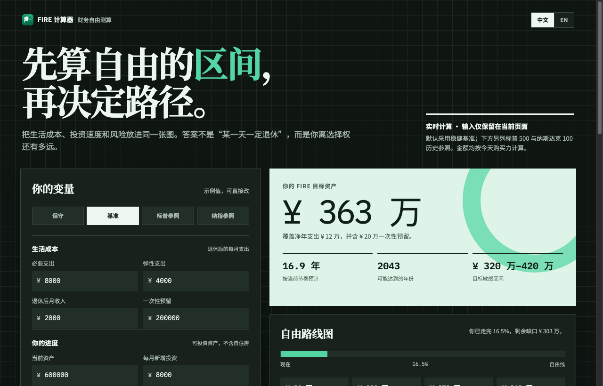

  <b>English</b> | <a href="#chinese"><b>中文说明</b></a>

# AILatest FIRE Calculator · Financial Independence Simulator 💰

  <b>Determine your financial freedom target range and timeline before choosing your lifestyle.</b> 
  财务自由极简测算器。基于 4% 安全提取法则与通胀复利模型，一键测算实现财务自由所需的资产目标与年限。免登录，计算仅在本地浏览器运行。

  
  
  
  

---

## 🖼 Visual Showcase

### 1. Official Cover Art

  

### 2. Live Application Interface

  

<em>Live screenshot captured from production: <a href="https://free.ailatest.org/zh/">free.ailatest.org</a>.</em>

---

## 🌟 Key Features

1. **Trinity 4% Safe Withdrawal Logic**: Computes exact baseline asset targets needed to cover living expenses in perpetuity.
2. **4 Calculation Benchmarks**:
   - **Conservative**: Lower expected yield, robust buffer.
   - **Baseline**: Balanced historical market baseline.
   - **S&P 500 Historical**: Benchmarked against S&P 500 real long-term returns.
   - **Nasdaq 100 Historical**: Higher growth model reflecting tech-weighted performance.
3. **Bear Market Stress Testing**: Models how a 20-30% market recession impacts your timeline and calculates how many additional years of savings would be needed.
4. **100% Local-First Privacy**: No data leaves your machine. Calculations happen client-side in pure JavaScript without server transmission.
5. **Interactive Progress Donut & Sensitivity Range**: Visualizes current asset progress (e.g. 16.5% reached) and outputs target sensitivity ranges (e.g. ¥3.2M - ¥4.2M).

---

### 🏷 Related Topics & Search Keywords
`fire-calculator` · `financial-independence-retire-early` · `4-percent-rule` · `trinity-study-calculator` · `retirement-simulator` · `bear-market-stress-test` · `passive-income-target` · `compound-interest-calculator`

---

  <a href="#top"><b>Back to Top (English)</b></a> | <b>中文说明</b>

## 🇨🇳 中文介绍 · AILatest FIRE Calculator

### 为什么需要 FIRE 计算器？
许多人想知道“到底攒够多少钱才能辞职换轻松工作”，但网上的测算工具要么强制收集手机号，要么计算模型粗糙。

**FIRE 计算器主打“先算自由的区间，再决定路径”**：
1. **多重基准对比**：支持「保守」、「基准」、「标普500历史参照」与「纳指100历史参照」四种场景一键切换。
2. **精细化收支模型**：分开录入必要月支出、弹性月支出、退休后被动月收入与一次性大额预留金。
3. **熊市压力测试**：测算经历资本市场回撤时，你的财务自由时间表会推迟几年，提前备足安全垫。
4. **绝对隐私保障**：计算逻辑全部在前端浏览器完成，不向云端发送任何财务数据，无需注册登录。

🌐 **立即在线体验**：[**https://free.ailatest.org/zh/**](https://free.ailatest.org/zh/)

### 🏷 热门搜索关键词与相关主题
`FIRE计算器` · `财务自由测算` · `提前退休计算器` · `4%安全提取率` · `被动收入测算` · `熊市压力测试` · `资产复利推演` · `财务自由需要多少钱` · `数字游民财务规划`
